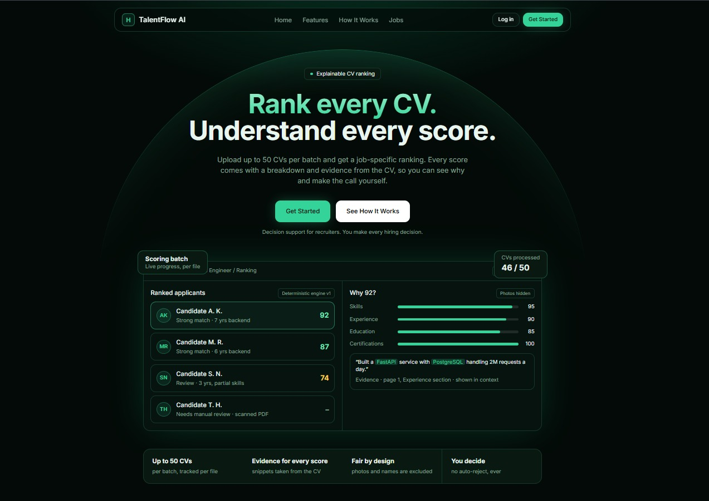
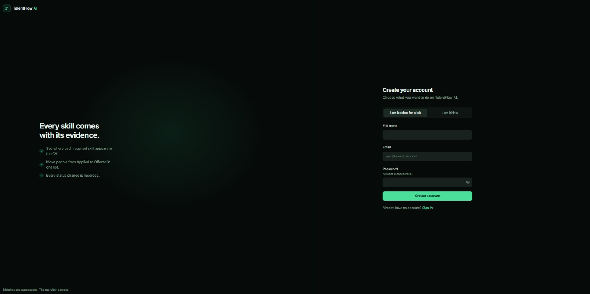

# TalentFlow AI

**Explainable recruitment decision-support platform (ATS) with
job-specific, evidence-backed CV matching.**\
Scores assist recruiters. They never make hiring decisions.

[](https://talentflow-ai-nine.vercel.app/)

**Live application:** <https://talentflow-ai-nine.vercel.app/>

## Screenshots

### Landing page



### Account registration



## Project Structure

```text
talentflow-ai/
├── backend/    FastAPI + SQLAlchemy + SQLite  (API on :8000)
└── frontend/   React + TypeScript + Vite + Tailwind  (UI on :5173)
```

The two folders are fully independent. Run them in two terminals.

## 1. Backend Setup (Windows PowerShell)

```powershell
cd backend
python -m venv venv
venv\Scripts\activate
pip install -r requirements.txt
copy .env.example .env
# Edit SECRET_KEY in .env
python -m app.seed
# Demo data is optional
uvicorn app.main:app --reload --port 8000
```

- **Swagger UI:** <http://localhost:8000/docs>
- SQLite database is created automatically as `backend/talentflow.db`.
- Private files live in `backend/storage/` and are never served
  statically.
- Run tests with `pytest`.

**macOS/Linux:** Use `source venv/bin/activate` and
`cp .env.example .env`.

## 2. Frontend Setup

```bash
cd frontend
npm install
npm run dev
```

Open <http://localhost:5173>. Vite proxies `/api` to the backend on port 8000.

For production, set `VITE_API_ORIGIN` (see `.env.example`) and run:

```bash
npm run build
```

## Demo Accounts

After running `python -m app.seed`, use either demo account:

Role Email Password

---

Recruiter `recruiter@demo.com` `Password123!`
Candidate `candidate@demo.com` `Password123!`

## Roles and Features

### Candidate

- Manage profile and profile picture.
- Upload multiple CVs; set a default CV, replace, delete, or download
  CVs.
- Search and filter available jobs.
- Apply for jobs, track application status, and withdraw applications.
- Receive notifications.

### Recruiter

- Manage personal profile and company profile, including company logo.
- Create and manage job postings.
- Bulk upload up to 50 CVs, with per-file processing status and retry
  support.
- View job-specific candidate rankings with score breakdowns and CV
  evidence.
- Review duplicate flags, add private notes, view status history, and
  access analytics.

Both roles support profile-picture upload with preview, replacement,
removal, and initials fallback. **Pictures, names, and other personal
attributes are never used in candidate scoring.**

## How Matching Works (v1)

1.  Extract text from PDF files using PyMuPDF or from DOCX files using
    `python-docx`.

2.  Detect skills using an alias dictionary and word-boundary regular
    expressions in `app/services/skill_extractor.py`.

3.  Calculate a configurable job-specific score using these components:

    Component Default weight

    ***

    Required skills 40
    Experience 25
    Education 15
    Preferred skills 10
    Keywords 10
    **Total** **100**

4.  Store an explanation and CV snippets as evidence for every score
    component. A skill that is **not found in the CV** is not
    automatically treated as a skill the candidate lacks.

## Contributors

Contributor Responsibility

---

**Kazi Sadman Zahin** Candidate module
**Abdur Rahman Tanvir** Recruiter module

## Notes

- Authorization is enforced in the backend through role checks,
  company ownership, and candidate ownership.

- Batch processing uses FastAPI background tasks. The UI polls for
  updates every 2 seconds.

- Set `DEBUG=0` in production. In debug mode, the password-reset token
  is returned by the API; no email service is included in v1.

- Back up the SQLite database regularly. For example:

  ```bash
  sqlite3 talentflow.db ".backup backup.db"
  ```

---

**TalentFlow AI is a decision-support tool. The recruiter remains
responsible for every hiring decision.**
